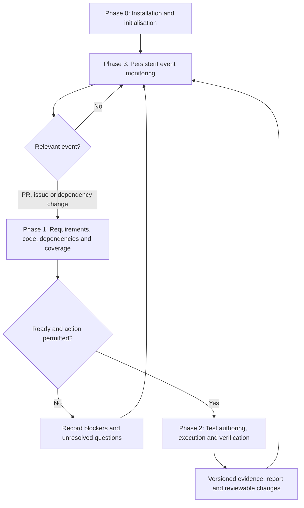
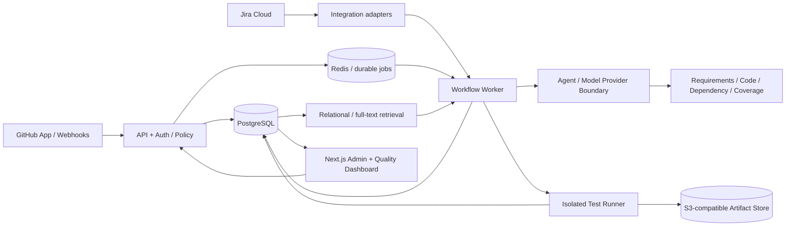

# CICERO AI (Cai)
## Product Vision, Functional Specification, System Architecture and Delivery Roadmap

> **Version:** 0.4 — Knowledge architecture and governance revision  
> **Date:** 4 November 2026  
> **Status:** Founding product specification; not an assertion that the software exists  
> **Product:** Cicero AI (Cai)  
> **Category:** Autonomous quality engineering / continuous regression intelligence  
> **Companion developer guide:** [`Agent.md`](./Agent.md)  
> **Codex entrypoint:** [`AGENTS.md`](./AGENTS.md)

---

## 1. Executive vision

**Cai is a continuously operating, evidence-driven AI quality engineering platform that understands what a software product is supposed to do, tracks how it changes across repositories and tickets, determines how it should be tested, and creates or executes meaningful regression tests within explicitly approved boundaries.**

Unlike a conventional AI test generator, Cai is not limited to a single PR. Cai maintains an evolving, version-aware record connecting business requirements, acceptance criteria, source changes, feature dependencies, test implementations, actual assertions, execution evidence, release candidates and unresolved risks.

**North-star promise:** *Understand the software. Protect its behaviour. Verify continuously.*

**Value proposition:** Help software teams recover QA engineering capacity, identify missing regression protection, and make safer release decisions. Cai is not a claim that software will become defect-free, that all testing can be automated, or that human SDETs can be eliminated.

### 1.1 Target customers

- **First design partners:** Software companies with approximately 10–100 developers, GitHub/Jira workflows, CI, and at least some TypeScript/Playwright adoption.
- **Primary users:** SDETs, QA automation engineers, developers, tech leads.
- **Budget owners:** Heads of Engineering, CTOs, engineering/QA managers.
- **Secondary users:** Product owners, security teams, release managers, auditors.
- **Later customers:** Larger regulated organisations requiring private deployment, advanced governance and audit controls.

### 1.2 Problems Cai solves

1. Test coverage is often measured by lines or test counts rather than verified business behaviour.
2. A feature spans multiple PRs/tickets, while testing decisions are made one PR at a time.
3. Teams build duplicate or expensive E2E tests where smaller tests would suffice.
4. Changes invalidate assertions, tests become stale or flaky, and release evidence loses relevance.
5. Engineers manually correlate Jira tickets, code, tests and deploys to decide if something is testable.
6. AI code generators can author tests without proving their assertions match intended behaviour.
7. Release stakeholders cannot easily see **what is known to work, what remains unverified, and why**.

### 1.3 Product outcomes

- Per-change risk and testing recommendation with traceable sources.
- Persistent cross-PR dependency and feature-readiness intelligence.
- Acceptance-criterion-level test coverage and provenance.
- Correctly selected unit/component/integration/contract/API/E2E tests.
- Reviewable, secure, maintainable test changes—not silent code mutation.
- Verified test results linked to correct commit, environment, build and requirements.
- Event-driven reevaluation when a blocking PR merges or a deployment occurs.
- Measurable developer time saved and lower rates of misleading quality claims.

### 1.4 Explicit non-goals

- No unconditional promise to replace a QA/SDET team.
- No claim that a green suite proves absence of defects.
- No silent modification of application source or weakening assertions to make tests green.
- No automatic bypass of branch protection, approval rules, security policies, or production gates.
- No requirement that every feature have a complete browser E2E test.
- No assumption that every Jira/Notion document accurately describes intended behaviour.
- No automatic external transfer of customer code just because the customer supplied a BYOK API key.
- No requirement to build a dedicated LLM agent for tasks better handled by ordinary software.

---

## 2. Core product invariants

These rules apply across **all** four phases and override convenience features.

1. **Evidence before confidence.** A requirement is *verified* only when an appropriate assertion has been demonstrated on the correct application version/environment; semantic similarity is never proof.
2. **Distinguish states.** Implemented ≠ deployed ≠ testable ≠ tested ≠ verified ≠ release approved.
3. **Provenance.** Every inferred requirement, mapping, dependency, test or decision links back to specific source versions and identifies inference versus fact.
4. **Uncertainty is valid output.** Inadequate documentation, ambiguous criteria or missing environments produce `unknown`, `blocked` or `requires-clarification`, not fabricated certainty.
5. **Test at the right level.** Use the organisation's configurable interpretation of Testing Pyramid and Testing Cup principles; avoid brittle or redundant E2E tests.
6. **Safe by default.** Read/analyse is the default. Writes, execution, CI changes and merges require explicit authorisation at the appropriate policy level.
7. **Privacy by design.** Customer data remains in customer-approved infrastructure except for separately approved model-provider calls/integrations. BYOK alone is not a data-residency guarantee.
8. **Reproducibility.** Decisions and outputs carry software version, input hashes, prompt/model version when applicable, policy version, environment and timestamps.
9. **Human accountability.** Developers and approved reviewers remain responsible for released software.
10. **Operational resilience.** Duplicate events, retries, crashes and provider outages cannot cause uncontrolled repeat work or falsely current dashboards.
11. **Cost boundedness.** Agent iterations, token spend, test execution and notifications are capped and observable.
12. **No privilege escalation from untrusted input.** Instructions embedded in PRs, issues, docs, code or test logs are data—not authority.

---

## 3. Key terms and status vocabulary

| Term | Definition |
|---|---|
| **Change** | A versioned PR/MR diff associated with a branch, commits and optionally requirements. |
| **Requirement** | Intended observable functional or non-functional business behaviour, linked to a source. |
| **Acceptance criterion (AC)** | Independently assessable condition and expected outcome. |
| **Feature dependency** | A precondition for implementing, deploying or verifying another requirement. |
| **Evidence** | Source-linked record supporting a claim: assertion, test result, build, approved requirement, etc. |
| **Candidate coverage** | A test that looks related to an AC but has not proven appropriate verification. |
| **Verified coverage** | Mapped assertion that passed against applicable application/environment versions. |
| **Coverage gap** | A sufficiently defined criterion lacking appropriate valid verification. |
| **Blocked** | Work cannot proceed due to a known missing prerequisite. |
| **Unknown** | Current information is insufficient to make a reliable determination. |
| **Cai run** | Persisted execution of an orchestrated workflow, with state, approvals, costs and audit events. |
| **BYOK** | Customer supplies and controls its own approved model API credentials. |
| **Testing Cup** | A configurable complementary test-level strategy, not a fixed or universal numeric quota. |

**Requirement coverage states:** `unknown`, `candidate`, `implemented_unverified`, `partially_verified`, `verified`, `stale`, `failed`, `blocked`, `not_applicable`.

**Readiness dimensions:** `code_ready`, `feature_ready`, `environment_ready`, `data_ready`, `approved_for_execution`—each independently evaluated.

---

## 4. Four-phase lifecycle overview



- **Phase 0** is installation/onboarding with ongoing configuration management.
- **Phase 1** runs for relevant source, requirement and dependency events.
- **Phase 2** operates on a specific, authorised test action plan.
- **Phase 3** runs continuously where an always-on service/runner exists; event-driven does **not** mean uninterrupted model inference.

---

# PHASE 0 — Installation, configuration and initialisation

## 0.1 Deployment options

Customer chooses one supported operating model:

**A. Customer-managed/self-hosted runner (initial target)**
- Service runs on customer-approved Docker host, VM, private network or CI runner.
- UI can be accessed by authorised developers; a local UI alone is not sufficient for constant monitoring.
- Persistent API, worker, database and durable event queue survive workstation shutdown/restart.
- Source code and analysis artifacts stay in approved storage, except explicitly authorised model-provider transmissions.

**B. Remote orchestration + customer-controlled execution (later)**
- Orchestration endpoint is hosted separately; code execution remains in customer-approved runners.
- Explicit data boundary, trust, network and telemetry policy.

**C. Fully private enterprise (later)**
- All Cai components and private model endpoint hosted within customer-approved infrastructure.
- Organisation takes responsibility for operating the model endpoint and supporting resources.

**Acceptance criteria:** Installation documentation states exactly which endpoints receive source/docs/logs; admin can choose and test the selected deployment model; persistent monitoring is never claimed for an offline developer-only process.

## 0.2 Organisation and installation identity

Create organisation/workspace, authorised admin account(s), application(s), repository scope, service identity, and tenant boundary. Support environment labels (`dev`, `integration`, `staging`, etc.). Preserve migration/version identifiers.

**Acceptance criteria:** An admin can inspect/disable each integration and data scope; installation can recover with original state and without duplicate indexing.

## 0.3 Model and BYOK setup

- Connect approved model endpoint with secret-manager-backed key; never plaintext commit or UI echo.
- Expose precise policy for allowed snippets, attachments, retention, PII/secrets filtering, tracing and external egress.
- Configure per-operation budget, token cap, total spend cap, retries, timeouts and model fallback.
- Support a **deterministic mock provider** for integration tests and local development.
- Design a narrow model-provider interface from day one; support one production provider in MVP, others later.
- Turn off or customer-configure external tracing before using sensitive customer material; SDK tracing must be explicitly reviewed.

**Acceptance criteria:** Product can run its mock workflow without real keys; disabling external AI prevents outbound model calls; warnings accurately explain BYOK transfers.

## 0.4 Automation framework and language selection

| Test level/framework | Supported languages | Plan |
|---|---|---|
| Playwright E2E | TypeScript | **MVP** |
| Playwright E2E | JavaScript, Python | Later |
| Cypress E2E | TypeScript, JavaScript | Later |
| Unit/component/integration | Existing application-native frameworks, e.g. Vitest/Jest/pytest | Discover and reuse; narrow MVP scope |

Never offer Python as a Cypress authoring language. The system must detect unsupported configuration combinations and explain them.

## 0.5 Discover or bootstrap automation

**Existing framework:** Identify test locations, config files, fixtures, page objects, CI scripts, naming standards, assertion patterns, tags, runtime context and historical results. Produce an index; do **not** rewrite the customer's test suite during setup.

**No existing framework:** Propose a minimal project/repository layout, Playwright configuration, sample fixtures, environment handling, deterministic demo tests and CI workflow in a reviewable branch. Ask for approval before writing shared repositories.

Unit tests generally belong in application-native project locations rather than always in a standalone E2E repository.

**Acceptance criteria:** Existing tests remain unchanged after read-only onboarding; new scaffold generation produces valid TypeScript and runnable example tests on a safe demo app.

## 0.6 Integrations and permissions

- **MVP:** GitHub App/webhooks, Jira Cloud API, existing Playwright repo, GitHub Actions or approved runner.
- **Later:** GitLab, Bitbucket, Notion, Azure DevOps, additional CI/CD providers.
- Use OAuth or installation-based access where appropriate; short-lived least-privileged credentials.
- Separate `repository.read`, `issues.read`, `tests.execute`, `branch.write`, `pr.create`, `ci.modify`, `merge`, `admin.configure`.
- GitHub webhooks must validate `X-Hub-Signature-256` over raw body, dedupe `X-GitHub-Delivery`, enqueue quickly and handle redelivery safely.
- Jira requests must support ADF description extraction, pagination, rate limiting and explicit document/issue permissions.

**Acceptance criteria:** A missing permission yields a clear actionable status; unauthorised actions fail closed, with an audit record.

## 0.7 Quality standards and approval policy

Allow default or customer-supplied standards for naming, assertions, reusable utilities, avoiding arbitrary waits, test data, accessibility considerations, mocking boundaries, severity, risk, coverage goals, budgets and review practices.

Three proposed autonomy modes:

1. **Advisory:** Read-only analysis and recommendations; no generated writes or execution without explicit approval.
2. **Supervised (MVP default):** Analysis automatically; individual execution/test PR operations require approval unless pre-authorised by policy.
3. **Autonomous within policy (later):** Pre-authorised isolated test actions can run, but merge/prod operations retain separate hard gates.

Policies are versioned. Changes to rules should revalidate dependent plans without reinstalling.

## 0.8 Security and compliance configuration

- Secrets and sensitive customer data must be redacted from prompts, logs and traces where feasible; model routing obeys approved disclosure policy.
- Execution of untrusted PR code/test code requires isolated, resource-limited runners: unprivileged process, restrictive filesystem, short-lived tokens, controlled network egress and ephemeral workspaces.
- Never mount host Docker socket or broad host filesystem into an untrusted job by default.
- No unsupervised production writes, destructive database operations or bypass of required reviews.
- Treat documentation, code comments, issues and tool results as untrusted against prompt-injection attempts.
- Record who approved which action, against which repository/version, and when.
- Define retention, audit export and deletion behaviour; avoid retaining entire repositories when metadata and hashes suffice.

## 0.9 Initial product indexing and persistent knowledge

Ingest approved repositories, tests, Jira issues/epics and explicit links. Establish source-backed entities (requirements, ACs, commits, changes, components, tests, evidence and dependencies). Deduplicate source identities and record timestamps/version hashes.

Inference can propose additional links but must mark them `inferred`, with explanation and confidence. Never automatically upgrade inference to confirmation because an LLM repeats it.

> **Storage and ownership requirement:** All installation modes must adhere to §5 (canonical PostgreSQL knowledge, customer-scoped data, object evidence, lifecycle and export), with privacy disclosures before any indexing.

## 0.10 Phase 0 readiness gate

Installation is complete when:

- [ ] Organisation, repo, environment and access boundaries persist.
- [ ] Integration credentials and webhook signing verified.
- [ ] Model endpoint or mock provider health tested; spend policy applied.
- [ ] Existing test suite indexed or safe starter scaffold proposed.
- [ ] Standards, approval policy and retention reviewed.
- [ ] Event intake, durable persistence and recovery tested.
- [ ] Administrator receives an accurate readiness and limitations report.

---

# PHASE 1 — Requirements, code and test intelligence

## 1.1 Trigger and change intake

Trigger on new/updated PRs; later also issue changes, merge events, build/deploy events, feature flags or scheduled rechecks. Capture webhook delivery ID, repository, installation, PR number, target/source refs, commit SHAs, changed files, author, labels, CI state and timestamps.

Events must be safely idempotent; self-generated test PRs should not create recursive cycles. A later PR version supersedes an earlier assessment but does not destroy its evidence.

## 1.2 Part A — Understand the intended change

**Step 1: Discover linked requirements.** Parse explicit Jira keys, PR descriptions, linked docs, issue relationships, epic membership and commits. Search only accessible, permitted context. Evidence ranks explicit first, inferred second.

**Step 2: Structured requirements extraction.** For each user story/AC preserve:
- Stable identifier and source URL/ID/version.
- Business goal and target personas.
- Preconditions and intended positive outcomes.
- Negative/boundary/security conditions **only where supported**, or mark as proposed questions.
- Expected side effects and important nonfunctional constraints.
- Status `explicit`, `inferred`, `ambiguous`, `conflicted` or `unknown`.
- Open questions requiring product/developer clarification.

**Step 3: Analyse code impact.** Determine affected modules, endpoints, UI, schemas, feature flags, service contracts and existing tests. Prefer static/deterministic parsing; LLM assists with interpretation. If the code contradicts approved acceptance criteria, flag potential implementation mismatch without assuming the code is correct.

**Step 4: Create a per-PR change intelligence record.** Store source links, versions, evaluated risk, changed components, inferred impacts, unresolved issues and recommended analysis scope.

## 1.3 Part B — Cross-PR dependencies and test readiness

Cai must understand that an epic may comprise several changes over time; not all planned work is yet written down.

The **Dependency Intelligence Engine** maintains a persistent versioned graph connecting:

`Epic → Story/AC → PR/commit → component/contract → deployment/flag/data dependency → test → execution evidence`.

Each edge has `relation_type`, source(s), `confirmed|inferred|rejected`, confidence/notes, creation/version and last-verified timestamp.

**Readiness dimensions:**
- **Code readiness:** Relevant code and contracts appear implemented or a testable isolated component exists.
- **Feature readiness:** Known mandatory dependent functionality is implemented; report unplanned/unknown work separately.
- **Environment readiness:** Correct build deployed, services available, feature flags configured.
- **Data readiness:** Safe fixtures, accounts and third-party sandboxes available.
- **Authorisation readiness:** Required approval/policy available.

**Partial feature case:** Isolated service logic exists, full UI journey absent. Cai checks for existing unit/component/API/contract coverage and may propose lower-level tests using native frameworks. It must not force an E2E test or imply a full integrated flow is proven.

**Lower-level coverage exists, E2E blocked:** Cai reports current evidence, known blockers and unknowns, then subscribes to follow-up events.

**Implementation complete but no deploy:** Mark `environment_blocked`. Re-evaluate on valid deployment/flag/test-data event.

**Unknown dependencies:** Explicitly report no guarantee that all future PRs are known. Unknowns never become automatically satisfied by elapsed time.

## 1.4 Part C — Coverage intelligence and three scenarios

**Step 1: Discover existing tests.** Index test names, files, code symbols, assertions, fixtures, test tags, metadata, committed version, applicability and execution records. Semantic similarity suggests candidates; it does not establish coverage.

**Step 2: Map ACs to actual assertions.** Ask what behaviour an assertion demonstrates and under which fixtures. Distinguish a test's existence from observed successful execution. Record environment/version suitability, positive/negative conditions and residual risk.

**Coverage states:**

| State | Meaning |
|---|---|
| `candidate` | Related test found; not proven relevant. |
| `implemented_unverified` | Reasonable test/assertion exists, no applicable successful run. |
| `partially_verified` | Only some conditions verified. |
| `verified` | Applicable assertion(s) passed against intended app/build/environment. |
| `stale` | Coverage evidence relates to obsolete versions or requirements. |
| `failed` | Relevant test fails with preserved evidence. |
| `blocked` | Requirement cannot currently be verified for known reasons. |
| `unknown` | Insufficient evidence for credible classification. |

An optional coverage percentage must be computed from *explicit covered AC/condition units* with version-qualified evidence; an arbitrary 80% semantic similarity threshold is **not** valid coverage. Risk weighting and mapping methodology must be visible.

### Scenario 1 — Existing tests sufficiently cover the requirement

Return mapped tests, assertions, run history, evidence recency and residual risk. Offer/authorise targeted execution in Phase 2. If the suite is outdated, it is not automatically `verified`.

### Scenario 2 — Relevant tests exist but require modifications

Show which assertions need updating and why, what must remain unchanged, and which new conditions need coverage. Propose reviewable changes in Phase 2; do not weaken tests to match a possibly broken application.

### Scenario 3 — Adequate tests do not exist

Produce a risk-ranked Test Action Plan using unit/component/integration/contract/API/E2E strategies. Identify environment prerequisites, approval requirements and cost expectations. Advance to Phase 2 only when permitted and testable.

> **Persistence rule:** Phase 1 knowledge writes and invalidation follow §5.3–5.4. Analysis is versioned by source snapshot; inferred links may not become confirmed merely through repetition.

## 1.5 Phase 1 output contract

For each processed change store a `ChangeAssessment` containing:

- Change ID, repo, PR SHA, related tickets, source versions.
- Explicit and inferred requirements, ACs and open questions.
- Component impact, known/inferred dependency graph edges.
- Readiness dimensions and blockers.
- AC→test/assertion/evidence mappings and classification scenario.
- Recommended Test Action Plan and approval state.
- Risk assessment **with supporting explanation**.
- Model/policy version, costs and audit references.

**Exit states:** `assessment_ready`, `awaiting_clarification`, `blocked_by_dependencies`, `blocked_by_environment`, `needs_approval`, `failed_with_reason`.

**Phase 1 acceptance criteria:**
- [ ] Correctly identifies a cross-PR dependency in seeded examples.
- [ ] Does not claim unimplemented/deployment-blocked E2E as ready.
- [ ] Never equates test name or semantic match alone to verified AC coverage.
- [ ] Produces source-linked requirements and flags missing/conflicting criteria.
- [ ] Correctly chooses among reuse, update and new-test scenarios in golden cases.
- [ ] Re-evaluates only affected items after relevant new events.

---

# PHASE 2 — Test authoring, execution and verification

> Initial comprehensive draft. Execution and permission details must be validated using deliberately safe test applications before commercial use.

## 2.1 Build an executable Test Action Plan

Each plan includes requirement/AC IDs, test levels, proposed operations (`reuse|update|create|execute|revalidate`), target environment/build, required data, safe runner, expected evidence, resource budget and approval policy. Treat plans as immutable revisions with status transitions; never execute a stale or revoked plan against a changed commit without revalidation.

## 2.2 Scenario 1: execute existing tests

1. Check current test definition is associated with intended AC.
2. Validate committed version, required deployed build/flag/services, data accounts and runner availability.
3. Resolve approval and permissions.
4. Select relevant test files/tags via change-impact analysis; expand scope for uncertain critical dependencies.
5. Execute in an isolated, budgeted runner.
6. Capture result, structured test steps, assertion evidence, logs/traces/screenshots if enabled, commit/build/environment IDs and artifacts policy.
7. Update coverage only for supported assertions on a genuinely applicable run.

**Do not:** call `passed` proof of all requirement variants; leak screenshots/logs by default; blindly retry until green.

## 2.3 Scenario 2: modify existing tests safely

1. Identify expected behaviour change with approved requirement evidence.
2. Inspect test code, fixtures, common helpers, data ownership and adjacent regression cases.
3. Generate a **minimal** modification plan explaining kept, changed and added assertions.
4. Work only in isolated branch/worktree; never mutate customer default branch directly.
5. Run lint/typecheck, focused tests and relevant additional tests.
6. Refuse to silently delete historical business coverage or turn assertions into no-ops.
7. Open a reviewable test PR with requirement links, diff rationale, validation and known limits.
8. Wait for human review or specific policy approval.

## 2.4 Scenario 3: generate new tests at appropriate level

Strategy Agent chooses among:

- **Unit:** Pure calculations, validation rules, deterministic logic.
- **Component:** Local UI/component behaviour with explicit controlled dependencies.
- **Integration:** Databases, internal services and shared modules.
- **Contract:** Producer/consumer API compatibility.
- **API/service:** Observable endpoint behaviour and authorised access.
- **E2E:** Critical fully integrated user journeys available in real test environment.

Generation follows customer framework, coding style, fixtures, config, naming, safe data handling and existing patterns. Each generated test has a mapping to one or more ACs and assertions. Positive, negative, boundary and authorisation cases must be justified by requirements/risk, not invented as authoritative business rules.

Prefer independent, deterministic tests with stable locators and bounded awaits; avoid arbitrary sleeps and fragile selector assumptions.

## 2.5 Verify generated tests rather than just compiling them

Validation ladder:

1. **Static:** Schema/type/lint, test discovery, import resolution and forbidden-operation checks.
2. **Structural:** Test isolation, fixture correctness, meaningful assertions and duplication.
3. **Dynamic:** Safe execution against known build/environment; capture evidence.
4. **Semantic:** Assertions genuinely correspond to intended AC and expected outcomes.
5. **Strength (where safe):** Deliberately failing negative fixtures or targeted mutation checks confirm an assertion can detect an important violation.
6. **Review:** Human approval for shared repository writes and policy-sensitive operations.

A generated but unexecuted test is `implemented_unverified`, never `verified`.

## 2.6 Failure classification and bounded remediation

Classify `possible_product_regression`, `obsolete_test`, `test_defect`, `environment_failure`, `data_failure`, `flaky_or_non_deterministic`, or `unresolved`. Evidence must support any proposed diagnosis. Allow bounded repeat runs for triage, preserve initial failures, and label uncertainty.

- Product bug suspected → inform developer, link evidence, no automatic production source modifications.
- Test code defect confirmed → propose isolated fix PR; approval gates apply.
- Environment/data issue → mark blocked and retry when prerequisites change.
- Flaky → record rate/conditions; no indefinite auto-rerun or blanket quarantine.

## 2.7 PR integration and approvals

All generated/modified tests are submitted via a named `cai/*` working branch or isolated worktree and reviewable PR; obey branch protections and access rules. A generated PR must carry provenance, source requirements, affected tests, execution evidence and limitations. Mark self-authored events to avoid loops; this marker cannot suppress legitimate externally introduced changes.

Default for MVP: Cai may propose changes but may not merge them. Later autonomous modes permit **only explicitly authorised** operations and cannot unilaterally expand permissions.

> **Artifact and verification rule:** Phase 2 reports and traces follow §5.2, §5.3 and §5.8 for sensitivity, versioned references and retention.

## 2.8 Reporting and quality evidence

Each action produces an audit-friendly summary: target requirement, requested action, selected tests, executed tests, status, version, environment, failures, risk, PR links, cost/latency and outstanding approvals. Update graph relationships only with evidence and preserve historic records across later changes.

## 2.9 Phase 2 completion states

`passed_verified`, `failed_with_evidence`, `created_awaiting_review`, `updated_awaiting_review`, `generated_unverified`, `blocked`, `requires_human_investigation`, `cancelled`.

**Phase 2 acceptance criteria:**
- [ ] Generated test includes a useful assertion tied to an AC; static tests alone do not mark it verified.
- [ ] Isolated execution records exact commit/build/environment and artifacts policy.
- [ ] Incorrect assertion can produce a failure in a controlled negative test.
- [ ] Failure auto-remediation does not weaken required assertions.
- [ ] Reviewable test PR produced; no direct default-branch mutation.
- [ ] Approval is bound to plan revision, tenant, repository, commit and operation type.
- [ ] Crashes/cancellations do not leave an unbounded or privileged runner active.

---

# PHASE 3 — Continuous monitoring and regression protection

> Initial comprehensive draft. Phase 3 spans and reactivates Phases 1–2.

## 3.1 Observe development events

Ingest and dedupe subscribed GitHub/Jira/CI events: PR opened, synchronised, merged, closed; issue/AC/epic changed; CI completed; deployment completed; feature flag/config changed (where supported). Support scheduled reconciliation to recover missed webhook deliveries. Event handler must persist safely and acknowledge promptly; heavy analysis occurs asynchronously.

## 3.2 Re-evaluate dependency resolution

On relevant new PR/merge/deploy/flag/data event:
1. Find graph nodes with matching affected dependencies.
2. Update known states while preserving evidence and inferred/unknown distinctions.
3. Re-evaluate readiness dimensions.
4. Trigger focused Phase 1 reassessment if meaningful change occurred.
5. If appropriate, queue a new Test Action Plan and permission gate.
6. Notify responsible users once per meaningful state transition.

Do not claim that all requirements are complete just because known PRs merged.

## 3.3 Regression suite health

Monitor execution pass/fail trends, repeat failures, flakiness evidence, duration, unexecuted tests, stale coverage, broken fixtures, removed components, changed business requirements and relevant dependency changes. Distinguish product defect risk from runner/infrastructure issues.

## 3.4 Intelligent test selection

Use graph dependencies and changed components to rank affected unit/integration/API/E2E suites. Prioritise cheap, reliable and relevant checks; include smoke or broader regression suites for critical or uncertain changes. Maintain an explainable rationale for both selected and intentionally excluded suites, subject to company policy.

## 3.5 Release readiness and quality confidence

For a selected release candidate (commit/build/environment), show:
- ACs verified with applicable execution evidence.
- Coverage gaps, partials, stale or unknown cases.
- Open bugs and failing/flaky tests.
- Blocked tests and unfulfilled deployment prerequisites.
- Changed critical components and test-selection scope.
- Provenance and timestamp of each conclusion.

Any composite quality score must expose its formula/weights and cannot guarantee no defects. Advisory report is MVP; configurable enforced quality gates are later and must be human-defined.

## 3.6 Notifications and collaboration

Support dashboard and PR comments initially; later Jira comments, Slack/Teams and release channels. Notify on actionable missing coverage, newly testable features, regressions, pending approvals, degraded monitoring, or meaningful release-status change. Dedupe/throttle and allow snooze/acknowledgement; avoid spam.

## 3.7 Maintain versioned knowledge

Preserve source versions, graph revisions, obsolete links, past test outcomes, historical requirement changes and review decisions. Rebuild indexes incrementally and provide auditable reconciliation against source systems. Delete/redact data under customer retention policy. Enforce the full knowledge lifecycle, invalidation, metrics, export/deletion and cost boundaries in §5; monitoring must report stale indexes and failed retention jobs.

## 3.8 Governance and economics

- Durable queue, idempotent handlers, exponential backoff with jitter and bounded retries.
- Dead-letter queue and reprocess/replay controls; no repeated side-effect PR creation.
- Per-organisation rate limits, job concurrency, LLM budget and sandbox quotas.
- Model call only for uncertain/semantic work; deterministic state processing otherwise.
- Feature-level throttling and notifications rather than chatty polling.
- Scheduled health and consistency reconciliation.

## 3.9 Monitor Cai itself

Detect disconnected GitHub/Jira installations, permission loss, stale webhooks, runner health, exhausted model budget, missing secrets, failed jobs, queue backlogs and schema migrations. Mark quality evidence *stale* when monitoring cannot keep up; never silently present old status as current.

## 3.10 Phase 3 monitoring loop

`OBSERVE → FILTER/DEDUPE → UPDATE STATE → DETECT MATERIAL CHANGE → ASSESS → APPROVE/EXECUTE → VERIFY → REPORT → OBSERVE`

**Phase 3 acceptance criteria:**
- [ ] PR/dependency/deploy changes cause targeted reevaluation and no uncontrolled duplicate jobs.
- [ ] Interrupted worker resumes/retries safely with idempotent effects.
- [ ] Model is not called for irrelevant events.
- [ ] Unavailable integrations visibly degrade confidence and trigger appropriate notification.
- [ ] Approval revocation prevents pending unauthorised execution.
- [ ] Release report distinguishes green tests from verified ACs and unknown risk.

---

## 5. Persistent knowledge, organisational intelligence and data governance

> **Architecture decision (v0.4):** PostgreSQL is the canonical persistent store for customer-scoped facts, workflows and a versioned dependency graph. Large execution artifacts reside in S3-compatible object storage. Semantic vectors are an **optional derived index** (pgvector if justified), never the source of truth. The MVP is customer-managed and single-customer per installation; future hosted multi-tenancy requires a separately reviewed isolation design. This section is binding across all four phases and is the authoritative reference for data ownership, retention and knowledge-growth behaviour.

### 5.1 What “Cai learns over time” means—and what it does not mean

Cai's organisational learning is **persistent, governed retrieval of evidence and evaluated relationships**, not silent training or modification of the foundation model. As new approved PRs, Jira stories, tests, deployments and run results arrive, Cai continuously updates a version-aware map of how the software works and how it is verified. Later agent invocations retrieve only relevant authorised context from this store.

A learning event is valuable only when it **improves the accuracy, coverage, timeliness or reuse** of the knowledge. Blindly accumulating records is not a success measure. Every derived assertion must be attached to source evidence and uncertainty; it may subsequently be confirmed, contested, superseded, archived or deleted.

**Knowledge types:**

1. **Authoritative source metadata:** repository, commit SHA, PR revision, Jira issue/version, deployment identity, test file revision, environment, timestamp and source link.
2. **Normalised requirements:** acceptance criteria, assumptions, actors, negative cases, explicit ambiguities, source versions.
3. **Dependency knowledge:** confirmed/inferred/contested graph links among issues, PRs, components, feature flags, deployment prerequisites and tests.
4. **Verification knowledge:** test asset plus exact assertion, execution outcomes bound to tested code/commit/environment, and evidence for or against a criterion.
5. **Operational knowledge:** approved policies, templates, human reviews, overrides, past failures, flaky test patterns, cost and reliability measurements.
6. **Derived retrieval aids:** full-text indexes, summaries and optional embeddings, all rebuildable from authorised source records.

**Not learning:** retaining raw source files forever; claiming a test is valid because an AI said so; automatically fine-tuning a shared model on customer materials; transferring one customer's code, metadata, embeddings or derived insights to another customer; interpreting increasing record counts as increasing model intelligence.

### 5.2 Canonical storage design and deployment choices

| Layer | MVP choice | Stored content | Design rule |
|---|---|---|---|
| Canonical relational store | PostgreSQL, customer-managed | Tenant scope, repositories, source versions, requirements, graph edges, tests, assertions, workflow state, evidence metadata, approval/audit, usage meters | ACID state, FK constraints, migrations, backups; no raw model memory as truth |
| Graph representation | PostgreSQL node/edge/adjacency tables | Links with relation kind, provenance, certainty, validity interval and confidence notes | Recursive/indexed SQL initially; graph DB only after representative benchmarks |
| Search | PostgreSQL B-tree/GIN/full-text | IDs, text search, content hashes and retrieval filters | Source/version/tenant filters always precede semantic ranking |
| Semantic retrieval (optional, later) | `pgvector` extension in same PostgreSQL instance | Embeddings of approved, minimal, redacted text chunks with source refs | Embeddings are sensitive derived customer data; schema/version tracked and deletable |
| Large evidence files | S3-compatible object storage; local-compatible adapter for development | Playwright traces, screenshots, logs, video, reports and export bundles | Store references, hashes, sensitivity classification and retention in PostgreSQL, not the blob |
| Job scheduling | Durable queue with canonical workflow state in PostgreSQL | Attempt/lease/retry/correlation metadata | Redis/BullMQ may be a queue transport but must never become the only source of truth |
| Secrets | Customer-approved secrets manager or secure local mechanism | API credentials, encryption/signing key references | No plaintext secret columns, source files, logs, screenshots or LLM context |

**MVP posture:** one customer-managed installation with its own PostgreSQL database and own object-store namespace. Include `organisation_id` on customer-owned records to preserve a sound domain model, even when only one organisation is configured. Do not expose a SaaS-style multi-tenant product, or assert isolation between organisations, before separate security testing.

**Potential later hosted SaaS posture:** prefer isolated databases or strong independently validated tenant isolation. If shared PostgreSQL is eventually selected, enforce scoped access in the service layer **and** database-level row-level security where appropriate, with tests proving non-bypass and correct behaviour under migrations, backups, queries and admin tools. RLS is not a replacement for proper authentication/authorisation or operational separation.

### 5.3 Knowledge schema and provenance contract

The following is a **logical schema**, not a requirement to create every table during M0. Codex should evolve it through reviewed migrations, preserving traceability.

| Logical entity | Minimum information |
|---|---|
| `Organisation` / `KnowledgePolicy` | Identity, data region/installation, policy version, retention classes, budget configuration, export and deletion rules |
| `SourceRecord` / `SourceVersion` | External system, immutable source ID, version/SHA/ETag, observed time, content hash, sensitivity classification and canonical reference |
| `KnowledgeEntity` | Kind, identity, structured attributes, validity state, creation/update timestamps, originating source version |
| `KnowledgeRelation` | From/to IDs, relation type, `confirmed`/`inferred`/`contested`/`rejected`, reason, supporting sources, confidence rationale and valid-from/to |
| `KnowledgeReview` | Human/agent principal, reviewed statement, action, reason, source, timestamp and reviewer scope |
| `Requirement` / `AcceptanceCriterion` | Normalised expected behaviour, explicit source citation, ambiguity and source version |
| `TestAsset` / `AssertionEvidenceMap` | File path, test ID, version, assertion reference, mapping rationale, AC ID and current verification status |
| `Build` / `Environment` / `TestRun` / `TestResult` | Exact code/test revisions, environment, execution time, outcome and artifact references |
| `ArtifactRef` | Object key, checksum, bytes, media type, sensitivity, owner scope, expiry, version and access policy |
| `KnowledgeRevision` / `InvalidationEvent` | Changed inputs, affected links, prior/current revision, invalidation cause and reevaluation state |
| `ModelUsage` / `StorageUsageDaily` / `ExecutionUsage` | Customer/workflow/correlation, provider/model, token counts, estimated billed units, bytes, compute and timestamps |
| `AuditEvent` / `ExportJob` / `DeletionJob` | Principal, policy, action, outcome, request reference, scope, status, timestamps and verification record |

**Mandatory metadata for derived knowledge:** organisation; source pointer and immutable source version/hash; actor or agent/model identity; prompt/policy version when model-derived; created/observed times (UTC); certainty and explanation; superseding relationship; permitted retention class; correlation ID.

**Invariants:**

- A requirement's text may change: preserve a new `SourceVersion` and mark affected derived links for reevaluation rather than overwriting history invisibly.
- A test passing on build A in environment X cannot verify build B in environment Y without justified equivalence and current evidence.
- A deleted or revoked source is no longer retrievable from search, embeddings, reports or generated context after the applicable deletion workflow completes.
- Never place untrusted source text into agent instructions as privileged system guidance.
- Deduplicate identical source versions by source ID + version/hash; do not rely solely on the model deciding what changed.
- All cross-object links are tenant scoped and have referential integrity or explicitly model missing/external entities.

### 5.4 Knowledge ingestion, reconciliation and retrieval lifecycle

1. **Observe:** authenticated webhook or scheduled scoped reconciliation identifies a potentially changed source.
2. **Authorise:** validate tenant/repository access, source scope, policy, and permitted retention/transmission before fetching.
3. **Fetch minimally:** retrieve only necessary metadata/chunks, paginate/rate-limit, classify sensitivity and redact when possible.
4. **Version and deduplicate:** save immutable external IDs/version/hash, avoid re-analysis of unchanged inputs.
5. **Extract:** deterministic parsing first; schema-validated model inference only where semantic understanding is needed.
6. **Ground and review:** attach references and evidence; keep inferred relationships tentative; capture corrections and approvals.
7. **Link and invalidate:** update graph relations atomically and mark all downstream impacted coverage/readiness conclusions `stale` or `unknown` as warranted.
8. **Retrieve for next task:** apply organisation, role, source-visibility, time/version and policy filters **before** ranking/selecting context; include citations and ambiguity in agent prompt.
9. **Verify and publish:** only evidence-backed outputs advance coverage to `verified`; record decision, usage and reproducible context references.
10. **Reconcile and expire:** repair missing events, compact redundant derived data, rebuild indexes as needed and execute lifecycle policies.

Keep human corrections as **reviewed knowledge**, not as prompt-only instructions. Corrections should be attributed, versioned and capable of later reevaluation if requirements change.

**Retrieval design:** relational joins / full-text search first; hybrid metadata + text search after baseline; optional semantic retrieval if golden-set evaluations show better recall without damaging accuracy. Store embedding model/version, dimension, source chunk hash and generation status. No cross-customer embeddings or shared unredacted cache. Derived indexes must be fully reconstructible.

### 5.5 Verifiable knowledge-growth and quality dashboard

Show real improvement through time-windowed metrics **per organisation, repository and release**, with baseline comparisons and source links.

| Metric | Calculation / interpretation | Caution |
|---|---|---|
| Source coverage | Indexed, authorised up-to-date sources ÷ eligible known sources | Inaccessible sources are `unknown`, not silently omitted |
| Traceability completeness | ACs with current source-to-code/test relationship evidence ÷ eligible ACs | A link is not proof of verification |
| Verified AC coverage | ACs with meaningful assertion and applicable passing run ÷ in-scope assessable ACs | Separate blocked, unknown and excluded criteria |
| Dependency precision | Confirmed correct suggested edges ÷ all reviewed suggested edges | Fewer false edges is often better than more links |
| Gap detection precision/recall | Correct flagged gaps / all flagged gaps; correct flagged gaps / known true gaps in golden suite | Requires labelled ground truth |
| Evidence freshness | Median age and % stale/invalidated verification evidence | Historic green runs are not current coverage |
| Reuse and correction rate | Relevant earlier knowledge reused; reviewer corrections per comparable assessment | Trend must control for change complexity |
| Knowledge footprint | Rows, distinct versioned sources, edges, index bytes and object storage bytes | Size alone is not intelligence |
| Retrieval efficiency | Latency, tokens/context retrieved, % source-linked outputs, retrieval misses | Lower tokens should not sacrifice relevance |
| Operating cost | AI + runner + storage + backup + network per PR/AC/test outcome | Track useful outcomes, not only token spend |

Provide an **Evidence Quality** view showing `confirmed`, `inferred`, `contested`, `stale`, `blocked`, `unknown`, and `superseded`. Show trend charts only when historical observations exist; never seed fake growth data in a customer's dashboard. Metrics requiring labelled benchmarks must show `not measured` until evaluation data exists.

A growing knowledge base should have *measurably lower false-confidence rates, more accurate dependency linking, faster contextual retrieval and less repeated manual work* on comparable tasks. If error rates worsen as data expands, growth is a failure signal.

### 5.6 Customer ownership, licensing, portability and separation

**Proposed commercial contract posture, subject to solicitor review:**

- Cai's vendor retains ownership of the general-purpose platform source, orchestration software and non-customer-specific IP.
- Customer retains ownership or other applicable rights in its repositories, documents, test assets and source materials; the customer controls its tenant-specific derived knowledge, evidence and runtime data under the licence/DPA.
- Rights in newly generated test code and customer-specific artefacts must be specified explicitly by the agreement; do not assume universal ownership rules for AI outputs.
- No cross-customer reuse of source text, confidential dependency graphs, snippets, vectors, log contents or aggregated examples that could identify the customer.
- No training/fine-tuning of a shared model with customer content by default. Any future opt-in model improvement requires a separately scoped, revocable contract and technical controls; provider terms and actual processing must be documented.
- BYOK provider calls are controlled customer-to-provider processing; identify what content is transmitted, where, under whose account, with what retention and training settings. BYOK **does not** guarantee that content never leaves the customer's network.
- Cai vendor telemetry is off by default in customer-managed deployments, except strictly necessary, disclosed licence/check-in operations if the contractual model requires them. Such operations must not contain source content or secrets.

**Export standard:** authenticated, authorised and auditable export of source-independent data relationships plus linkable source IDs, policies, approvals, audit records, coverage mapping and run metadata in documented versioned JSON/JSONL or CSV formats, together with an artifact manifest and optional approved artifact bundle. A customer should be able to inspect and back up its knowledge without receiving the proprietary agent implementation. Protect export files using encryption/access controls and time-limited delivery. Document schema version and restore/migration compatibility.

**Offboarding:** disable integrations; cancel or revoke jobs; export if authorised; delete customer data and derived indexes according to retention/legal-hold obligations; purge relevant object versions/backups according to an explicit schedule; produce an auditable deletion report. Never claim instant irrevocable deletion where backup retention prevents it.

**Regulatory:** classify personal data and payment-related artifacts; determine customer/vendor controller/processor roles as deployed rather than assuming them. Establish appropriate DPA, legal basis, data residency, international transfer, retention and subject-rights handling for deployments where GDPR/UK GDPR applies. Do not claim PCI certification merely because a customer's product is in a PCI environment.

### 5.7 Security, resilience, backups and isolation

- **Identity and scope:** server-side authentication/authorisation and scoped data access, least-privilege integration accounts, per-installation service identities, audited privileged operations.
- **Encryption:** TLS between networked components, encryption at rest for database volumes, artifacts and backups, customer-approved key management and rotation; secrets managed separately. Local developer Docker is not automatically production-grade encryption.
- **Tenant boundaries:** per-customer DB/object namespace for self-hosted MVP; permission filters at every retrieval and export boundary. Shared SaaS isolation, RLS and administrator access need explicit threat modelling and penetration tests before launch.
- **Sensitive content:** restrict screenshot/trace/log retention, redact secrets/tokens and customer PII, disable unapproved third-party AI tracing, never index secrets as embeddings, avoid raw prompt/output persistence by default.
- **Reliability:** schema migration tests, transactional version/event updates, consistent artifact references, backup checks, point-in-time recovery where required and periodic **tested restore**. Backups are not an export substitute.
- **Tamper evidence:** append-only or integrity-protected audit trail for approvals, access, policy changes, exports and deletion, including actor, UTC time and correlation ID.
- **Visibility:** monitoring must flag overdue indexing, missing webhooks, failed reconciliation, stale evidence, excessive cost, compromised connector permissions and storage/backup failures.

### 5.8 Knowledge lifecycle, retention and compaction

Policies must be configurable by data category and contract; the numbers below are **starting suggestions for pilots, not universal defaults or compliance guarantees**.

| Category | Suggested pilot policy | Requirements |
|---|---|---|
| Raw webhook payloads and temporary diagnostic logs | Minimise; e.g. 7–30 days where safely needed | Redact sensitive fields, keep hashes/source refs where possible |
| Screenshots, video, traces and large logs | e.g. 14–30 days unless pinned for an incident | Expire automatically, protect incident/legal-hold evidence |
| Derived embeddings and transient summaries | Rebuildable; delete on source revocation/change | Do not retain superseded chunks indefinitely |
| Verified requirement and test-evidence metadata | Keep versioned history for agreed period; e.g. 12–24 months | Mark stale/superseded; retain justified audit lineage |
| Audit and security events | Contract/security-policy determined; e.g. ≥12 months where appropriate | Higher integrity, access restrictions, compliance exceptions |
| Backups | Short rolling retention with tested restore and documented delayed purge | Separate backup deletion commitments from live-data deletion |

Retention should support `active → superseded → archived → delete_pending → deleted` and exception/hold states. Compaction may remove duplicate fetched payloads or obsolete derived indexes **without erasing required provenance or audit history**. Deletion must cascade to search indexes, embeddings and object artifacts; use tombstones or minimal deletion audit proofs when legitimate.

### 5.9 Capacity, cost attribution and scale strategy

**Do not hard-code cloud-provider prices into the product.** Cost depends on region, provider, redundancy, retention, storage/operations, token pricing, API call patterns, runner size and network transfer. Store tariff versions/configuration, and distinguish measured spend from estimates.

Per-customer monthly total-cost model:

`Total = PostgreSQL compute + DB disk/indexes + DB backups/replicas + object GB-month + object requests/retrieval/egress + AI input/output/cached token charges + test runner CPU/RAM/runtime + queue/worker compute + monitoring/security/operations`.

Measure and attribute at least:
- **Storage:** DB data/index bytes, event/audit growth, artifact bytes and object request/transfer counts, backups and optional vector index footprint.
- **AI:** provider/model, prompt/completion/cache tokens, call count, repeated calls/retries, estimated currency charge and policy-budget usage by workflow.
- **Execution:** tests launched, browser minutes, parallelism, runner CPU/memory class, failure reruns and artifact production.
- **Effectiveness:** cost per processed PR, correctly identified coverage gap, accepted test PR and confirmed regression—not merely cost per token.

Use incremental source indexing, hashes and event-driven updates to avoid re-reading whole codebases. Limit document chunking, embedding generation, retry counts and stored screenshots. Budget controls must prevent denial-of-wallet, with alerts and fail-closed options when limits are exceeded.

**Scaling sequence:**
1. **MVP:** one customer-managed PostgreSQL instance; ordinary indexed joins; single worker; optionally a filesystem-backed development artifact adapter. No vector store required.
2. **Pilot:** measure representative query latency and database/index growth, add S3-compatible artifact storage and retention jobs, backups and restore drills; add `pgvector` only if retrieval benchmarks justify it.
3. **Growing teams:** incrementally index by source version, batch safe ingestion, partition/archive high-volume append-only events when measured, add worker concurrency and connection-pool controls.
4. **Hosted multi-customer:** separate capacity and tenant-isolation design; test data boundaries, encryption, access, recovery objectives and cost attribution before accepting confidential workloads.
5. **Enterprise scale:** assess dedicated graph services, search clusters and managed services *only after* repeatable benchmark evidence shows PostgreSQL or the chosen deployment cannot meet defined requirements.

**Benchmark scenarios:** 10x/100x fixture growth, re-indexing after connector outage, update/delete of one source with downstream invalidation, query over densely related multi-PR features, restore from a backup, export/offboarding, and budget exhaustion mid-workflow. Capture latency, result correctness, bytes, spend, failure recovery and isolation.

### 5.10 Acceptance criteria and milestone mapping

| Milestone | Required demonstrable knowledge/data behaviour |
|---|---|
| **M0** | Document storage ADR, schema/migrations strategy, ownership and secure defaults; start PostgreSQL locally; provide minimal safe persistence smoke test if database module exists. No real customer data or API credentials. |
| **M1** | Persist authenticated events with idempotency, source hashes, correlation IDs, tenant scope, workflow state and basic audit; survive restart without duplicate effects. |
| **M2–M3** | Preserve source versions/provenance; secure scoped GitHub/Jira retrieval; redact/minimise; unknown and contradictory requirements remain visible. |
| **M4** | Versioned nodes/edges with certainty, dependent invalidation and targeted reevaluation; old relation not silently overwritten. |
| **M5** | AC-to-assertion mapping with exact source/test revision; stale/failed/unknown distinguished from `verified`. |
| **M6** | Basic knowledge-quality and evidence freshness/status API/UI plus approval-bound policy decisions; `not measured` where no benchmark exists. |
| **M7** | S3-compatible artifact-store interface and development adapter, SHA/checksum/size/retention references, controlled access and execution-linked evidence. |
| **M8** | Configurable expiry/cleanup, metering/budget dashboard or API, backup/restore runbook and **tested restore**, data export with manifest, deletion workflow and auditable failure paths. |
| **Post-MVP** | Optional pgvector/hybrid retrieval only after evaluation; automated compaction, managed tenant isolation, customer-controlled keys, richer knowledge-growth analytics and certified security posture after external assessment. |

**Knowledge-focused golden tests:** source text changes; revoked repository access; wrong tenant/source link; passing test from wrong build; contradictory ACs; inferred edge rejected by reviewer; stale embedding from deleted source; duplicate webhook; object artifact expiry; cost limit reached; failed export; deletion with legal hold; backup restore consistency. These are required where the relevant capability exists and must not be “passed” by mocks when real integration behaviour is being asserted.

**Primary outcome:** Cai becomes more useful because it maintains **accurate, source-linked, versioned, revocable organisational knowledge**. Its storage footprint is an operational metric, not a proxy for intelligence.

---

## 6. Cross-phase architecture

### 6.1 Architectural style

**Modular TypeScript monorepo, customer-managed initially, with a deterministic orchestration core and specialised AI analysis services.** Components may run in one deployment initially but should maintain explicit interfaces so they can be split later.



**Proposed stack (reviewed at implementation time):**

| Concern | Initial choice | Why |
|---|---|---|
| Language | TypeScript (strict mode) | Shared types, Playwright familiarity |
| API | Fastify | Compact, typed endpoints and raw webhook support |
| UI | Next.js + React | Admin, approvals, traceability dashboard |
| Persistence | PostgreSQL + Drizzle or Prisma | Relational constraints and versioned evidence |
| Event queues | BullMQ + Redis | Durable background jobs and retries; Postgres remains source of truth |
| AI agent boundary | OpenAI Agents SDK or typed model adapter | Tool use and structured outputs with explicit policies |
| Test execution | Ephemeral isolated Docker/CI workers | Contain untrusted code and capture artifacts |
| E2E framework | Playwright + TypeScript | First implementation target |
| Local deployment | Docker Compose | Reproducible founder and pilot environment |
| CI | GitHub Actions | Works with MVP GitHub integration |
| Schemas | Zod | Runtime validation and TypeScript types |
| Logging/telemetry | Structured logs + OpenTelemetry-compatible interfaces | Privacy-aware observability |

**No automatic multi-agent swarm.** Start with one orchestrated semantic-analysis worker exposing separate typed tasks. Add specialist agents only when independent evaluation demonstrates that splitting them improves accuracy, reliability or cost.

### 6.2 Suggested repository layout

```text
cicero-ai/
├── Vision.md
├── Agent.md
├── AGENTS.md
├── README.md                         # created when implementation begins
├── .env.example                      # safe placeholders only
├── .gitignore
├── docker-compose.yml
├── apps/
│   ├── api/                          # auth, GitHub webhook, policy and API endpoints
│   ├── worker/                       # durable workflows, idempotency, orchestration
│   └── web/                          # onboarding, assessments, approvals, health
├── packages/
│   ├── contracts/                    # Zod schemas, event and state contracts
│   ├── database/                     # relational models, migrations and repositories
│   ├── integrations/                 # GitHub and Jira adapters
│   ├── intelligence/                 # model adapter and semantic analysis tasks
│   ├── coverage/                     # Playwright test discovery/mapping
│   ├── policy/                       # authorisation, budgets and safety gates
│   ├── executor/                     # narrow runner abstraction
│   └── observability/                # structured redacted audit/logging
├── fixtures/
│   └── demo-checkout/                # fully synthetic multi-PR fixture app
├── tests/
│   ├── unit/
│   ├── integration/
│   ├── contracts/
│   ├── security/
│   └── e2e/
├── docs/
│   ├── architecture/
│   ├── adr/
│   ├── api/
│   ├── runbooks/
│   └── evaluation/
└── scripts/
```

### 6.3 Key domain entities

Use consistent customer-scoped identifiers (`tenant_id` / `organisation_id`). PostgreSQL is the canonical state/evidence store; optional pgvector and S3-compatible artifact handling follow the binding knowledge design in §5. This table is a compact domain view; §5.3 defines the extended knowledge/provenance model.

| Entity | Important fields / relationships |
|---|---|
| `Organisation` | ID, policies, default deployment, retention and budgets |
| `User`, `Role`, `ApprovalPolicy` | Identity, action scopes, audit trail, versions |
| `IntegrationConnection` | Provider, installation ID, repo/project scope, encrypted secret reference, health |
| `Repository`, `Branch`, `Commit`, `PullRequest` | External immutable IDs, ref, SHA, author, status and timestamps |
| `ExternalDocument`, `Epic`, `Story`, `Requirement`, `AcceptanceCriterion` | External source, version/content hash, normalised text, provenance and ambiguity |
| `Component`, `DependencyEdge` | Endpoint/module/feature identity, relation, certainty, source, validity window |
| `TestAsset`, `AssertionEvidenceMap` | Path/symbol/framework, version, AC links, assertion rationale and mapping status |
| `Build`, `Deployment`, `ExecutionEnvironment` | Commit/build SHA, service versions, flags and environment identity |
| `TestRun`, `TestResult`, `ArtifactRef` | Test revision, executor, time, result, logs/traces policy and evidence |
| `CoverageAssessment` | AC, evidence, confidence explanation, coverage state, build and policy version |
| `ChangeAssessment`, `TestActionPlan` | Source snapshot, scenario, risks, steps, approvals and transition state |
| `Approval`, `AuditEvent` | Principal, action, plan revision, resource, expiry, outcome and timestamp |
| `InboundEvent`, `Job`, `DeadLetter` | Idempotency key, delivery hash, retries, lease, status and correlation ID |
| `ModelUsage` | Provider/model, tokens, budget, provenance, redaction and spend estimate |
| `Notification` | Idempotency/meaningful-transition key, recipients, channel and outcome |

**Data constraints:** Unique `(provider, installation, delivery_id)` for webhook dedupe; unique external entity identities per tenant; foreign keys and cascading/deletion policy; restrict all queries by tenant; use source hash/version to avoid stale reprocessing; ensure a test result cannot attach to the wrong build/version; immutable audit entries.

### 6.4 Workflow state models

**Inbound event:** `received → validated → persisted → queued → processed`, with `rejected`, `dead_letter`, `duplicate` paths. Respond to webhook after safe persistence/enqueueing; asynchronously perform heavy analysis.

**Change assessment:** `pending → collecting_context → analysing → awaiting_clarification|blocked|assessment_ready → superseded` with explicit retry/failure states.

**Test plan:** `draft → policy_checked → awaiting_approval|approved → queued → running → verification → report_ready|failed|blocked|cancelled`.

**Approval:** `requested → approved|rejected|expired|revoked`. Execution always rechecks authorisation against current revision and policy.

**Source of truth:** Deterministic workflow transitions and relational persistence; model outputs are *proposals* validated by schemas and policies.

### 6.5 Typed interfaces (illustrative; not yet compiled code)

```ts
type CoverageState =
  | 'unknown' | 'candidate' | 'implemented_unverified'
  | 'partially_verified' | 'verified' | 'stale'
  | 'failed' | 'blocked' | 'not_applicable';

type Certainty = 'confirmed' | 'inferred' | 'rejected';

type TestAction = 'reuse' | 'update' | 'create' | 'execute' | 'revalidate';

interface SourceEvidence {
  sourceId: string;
  sourceType: 'jira' | 'github' | 'test' | 'deployment' | 'human';
  sourceVersion: string;
  reference: string;
  observedAt: string;
}

interface AcceptanceCriterionAssessment {
  criterionId: string;
  state: CoverageState;
  candidateTestIds: string[];
  supportingEvidence: SourceEvidence[];
  limitations: string[];
  requiresClarification: boolean;
}

interface TestActionPlan {
  id: string;
  tenantId: string;
  changeId: string;
  targetCommitSha: string;
  action: TestAction;
  approvalPolicyVersion: string;
  requiredScopes: string[];
  criterionIds: string[];
  environmentId?: string;
  maximumEstimatedCost?: number;
  status: string;
}
```

These are contracts to evolve via migrations and ADRs, **not** a demand to implement every field at once.

---

## 7. AI design principles

### 7.1 Candidate agent responsibilities

1. **Requirements Intelligence:** Source-backed structured requirements, ambiguity and questions.
2. **Code Intelligence:** Semantic change impact and code-to-requirement relationships.
3. **Dependency Intelligence:** Evidence-backed cross-PR graph suggestions and readiness assessment.
4. **Coverage Intelligence:** Candidate test discovery, assertion-to-AC mapping and gaps.
5. **Test Strategy:** Risk-driven test layer selection and minimal action plan.
6. **Test Authoring:** Generate reviewable test code under existing patterns.
7. **Verification:** Evaluate test semantics, correctness and failures.
8. **Monitoring:** Primarily deterministic rules/queues; model used when interpretation needed.

A named agent is a *logical responsibility*, not a required separate LLM process or API call. It is acceptable and preferred for the MVP to implement several as typed functions/steps with one model adapter.

### 7.2 Model output and validation

- Use explicit JSON/Zod schemas, reference IDs, allowed enums and a maximum uncertainty/clarification output.
- Persist inputs/outputs only after redaction and under approved retention policy.
- No arbitrary model-generated shell invocation, unauthorised file access or direct privileged API calls.
- Access only narrow, policy-gated tools; validate paths, repositories, operation scopes and resource budgets.
- Retry schema failures a bounded number of times; escalate rather than invent valid data.
- Maintain prompt/model evaluation fixtures and versioning to avoid undetected drift.

### 7.3 RAG and context

Index metadata and relevant text snippets with source version. Start with relational search and targeted retrieval; embeddings/vector database are optional later. Filter accessible context by tenant and permission before sending to any model. Record what context was provided for a specific assessment.

---

## 8. UX and interaction vision

### 8.1 Onboarding wizard

Choose deployment, connect GitHub/Jira, select application/repositories, identify framework, configure model/BYOK privacy, set default policies, perform safe indexing, see readiness report.

### 8.2 Change assessment detail

Top of page: PR/commit/issue, high-level scenario `reuse|update|create|blocked`, critical risks, and approvals. Below: criteria table with source, actual evidence, status, explanation and proposed action. Dependency timeline shows blockers and their owners/sources. Do not hide unknowns behind a green badge.

### 8.3 Approval queue

Action, scope, exact target commit, generated diff, required rights, relevant evidence, environment and spend; controls to `approve`, `reject`, `defer` with rationale and expiry. All actions logged.

### 8.4 Quality health and release page

Time-bounded, environment-specific verified ACs, missing/stale/blocked criteria, trend in accepted generated tests, flaky tests, known regressions, monitoring health and per-team time saved. Report source and confidence methodology.

### 8.5 CLI (later or developer convenience)

Examples: `cai status`, `cai assess <pr>`, `cai coverage <feature>`, `cai plan <pr>`, `cai doctor`. CLI must use the same authenticated API and policy engine; no extra backdoor privileges.

---

## 9. Three end-to-end acceptance scenarios

### 9.1 Three-PR checkout epic

- PR #101 implements saved-card validation: full checkout not ready; unit coverage proposed or reused.
- PR #102 integrates payment gateway: API/contract test opportunity; E2E still blocked.
- PR #103 implements UI: code readiness potentially satisfied; deployment still blocked.
- Relevant build deployed, test account available, feature flag enabled: readiness changes.
- No existing complete journey test: Scenario 3 action plan generated.
- Approved test PR includes Playwright happy-path and justified negative cases; isolated execution creates version-qualified evidence.
- Later validation change triggers targeted rerun and regression evidence, without conflating infrastructure failure with a confirmed product bug.

### 9.2 Similar-looking but insufficient test

- Old test asserts successful transfer of £500.
- New requirement enforces a daily transfer limit.
- Semantic similarity may be high, but coverage state must be `candidate` or `gap`, **never** `verified` unless it asserts the limit correctly.

### 9.3 Contradictory requirements

- Jira AC says a customer can retry a failed payment once.
- Design note says retries are prohibited.
- Cai reports conflict, source versions and questions; does not invent a definitive test outcome or mark behaviour verified.

---

## 10. MVP boundaries and release plan

### 10.1 MVP definition

**An MVP exists only when a developer can demonstrate, on an entirely synthetic repository, the full path:**

1. Configure a local Cai organisation and safe mock AI provider.
2. Receive and authenticate a GitHub-style PR event (real integration once enabled).
3. Persist and process it idempotently.
4. Retrieve linked simulated/real permitted Jira requirements.
5. Link changed components to existing Playwright tests.
6. Classify an explicit AC as `verified`, `gap`, `blocked` or `unknown` with evidence.
7. Maintain a dependency across multiple PR events and respond when unblocked.
8. Produce a reviewable Playwright test draft under a supervised approval gate.
9. Run safe tests in an isolated demo environment and store build-bound evidence.
10. Present the results in a basic dashboard or clear API, including unresolved limitations.

Not required for MVP: full enterprise multi-tenancy, Cypress, Python Playwright, Kubernetes, Notion, all VCS providers, comprehensive release gates, private LLM hosting, fully autonomous merging or perfect repo-wide reasoning.

### 10.2 Delivery milestones with demonstrable gates

| Milestone | What Codex builds | Gate / observable outcome |
|---|---|---|
| **M0 — Repository baseline** | Toolchain, `AGENTS.md`, lint/typecheck/test, CI, Docker plan, documentation and ADRs | Clean install; tests/typecheck/lint green; no secrets |
| **M1 — Persistent event foundation** | API, PostgreSQL schema, safe queue, mock GitHub event, signature verification, idempotency | Same delivery twice → exactly one logical assessment; restart safe |
| **M2 — GitHub + Jira read-only** | GitHub App adapter, Jira OAuth/API, synthetic providers, retry handling | Linked PR/AC fetched with source version and minimum permissions |
| **M3 — Requirements + change intelligence** | Typed extraction, source references, ambiguity states, diff metadata | Golden test cases show explicit vs inferred requirements |
| **M4 — Dependency graph** | Persistent cross-PR edges, blockers, deploy-readiness signals | Three-PR seeded epic remains blocked then re-evaluates correctly |
| **M5 — Playwright inventory and coverage** | Test indexing, candidate search, assertion mapping and evidence states | Similar test is not falsely marked verified; no 80%-similarity shortcut |
| **M6 — Action plans and approval UI** | Typed test plan, policy gate, basic React UI | No write/execute operation without applicable approval |
| **M7 — Test authoring and safe execution** | Playwright draft generation, branch PR adapter, isolated demo runner | Useful test, negative-control failure, evidence, reviewable diff |
| **M8 — Monitoring and pilot hardening** | Focused reevaluation, retries/reconciliation, health, audit, cost caps | Crash recovery, dedupe and stale-data detection demonstrated |

Milestones should be completed **one vertical slice at a time**. Later roadmap in §10.3; detailed Codex implementation instructions in `Agent.md`.

### 10.3 Post-MVP expansion

- **V1 customer pilots:** Better GitHub/Jira admin integration, onboarding, policy modes, source-linked explanations, execution sandbox security review, full audit/retention, deployment docs, basic billing/entitlements.
- **V1.5:** GitLab/Bitbucket, Cypress, Python Playwright, Notion, additional CI runners, stronger failure triage, large monorepo indexing, more coverage filters.
- **V2 enterprise:** SSO/RBAC, multi-team applications, tenant separation validation, more granular approval and policy engines, stronger private deployment, quality gates and independent security assessment.
- **Later:** Enhanced mutation-based assertion testing, graph-backed release impact prediction, proprietary evaluation datasets, lower-cost provider routing, optional SDET workflow co-pilot features.

---

## 11. Evaluation and test strategy for Cai itself

### 11.1 Golden evaluation suite

Create a deterministic demo repository with:

- Three linked PRs implementing partial → complete checkout.
- Current and stale acceptance criteria, including contradictory ones.
- True positive/negative, misleadingly similar and duplicate Playwright tests.
- Hidden feature flag and deployment version mismatch.
- An intentionally buggy validation rule with a test that should fail.
- Missing Jira links, unknown dependencies and permission denials.
- Duplicate/redelivered webhooks and queue interruption.
- Prompt injection in a PR description instructing Cai to ignore rules.

### 11.2 Product measures

| Metric | What matters |
|---|---|
| True coverage precision | Avoid false claims that requirements were verified |
| Coverage gap recall | Catch important genuinely uncovered behaviours |
| Requirement traceability accuracy | Links to correct source and version |
| Test PR acceptance | Human reviewers accept useful tests with limited rework |
| Valid regression detection | Failures represent genuine product issues rather than noise |
| False positives and flaky tests | Low wasted engineer time and test maintenance |
| Human time saved | Actual net engineering capacity recovered |
| Agent cost and latency | Predictable cost per useful assessment/test plan |
| Workflow recovery | Repeatable idempotent events, restarts and retries |
| Security guardrails | No unauthorised write, secrets disclosure or untrusted execution escape |

Do not promise arbitrary numerical success targets without pilot baselines. Set measurable target thresholds after collecting fixture and first customer-pilot evidence.

### 11.3 Engineering test layers

- **Unit:** State machine, pure analysis, auth/policy, coverage statuses, diff/issue parsing.
- **Contract:** GitHub/Jira adapters and model/runner interfaces with mocks.
- **Integration:** DB persistence, queue retries, Graph evidence and approval transitions.
- **Security:** HMAC verification, IDOR/tenant isolation, prompt injection, secret redaction, executor constraints.
- **E2E:** Synthetic demo app, three-PR scenario, approval-to-test-PR loop.
- **Resilience:** Duplicate delivery, provider 429, stale SHA, worker crash, cancellation, dead-letter replay.

---

## 12. Security, trust and privacy requirements

### 12.1 Trust boundaries

- User-facing UI/API accepts only authenticated principals with scoped permissions.
- GitHub/Jira content is **untrusted input** and may contain adversarial instructions.
- AI model output is structured, validated and not an authority to perform side effects.
- Work execution is isolated and governed by a deterministic policy engine.
- Provider and SaaS integrations may be outside a customer's private network; consent and data flow must be explicit.
- Test artifacts can contain PII, credentials, screenshots and payment data; redact, restrict and expire accordingly.

### 12.2 Minimum controls

- HMAC-signed GitHub webhooks, least-privileged scoped tokens and OAuth/installation auth.
- Secrets vault or encrypted secure reference, rotation support, no secret echo or persisted plaintext.
- Customer-scoped database access enforced server-side, not only in UI filters.
- Immutable/high-integrity audit events and version-bound approvals.
- Prompt injection protections across sources; no unrestricted agent shell or API access.
- Isolated, resource-limited runner with network egress policy and no privileged Docker exposure by default.
- Safe logging/telemetry; explicit opt-in before external trace export or vendor usage analytics.
- Encryption at rest/transit appropriate to deployment; retention and secure deletion policy.
- Rate limits, budget caps and concurrency limits to prevent runaway costs.
- Signed or recorded generated change provenance; PR reviews and rollback/disable controls.
- Security review and customer approval before processing real confidential enterprise code.

### 12.3 Independent development policy

The initial synthetic project and all prototypes must be authored using **independent personal tools, accounts and synthetic/open-source authorised materials only**. Do not incorporate an employer's private source code, Jira issues, internal documents, credentials, test fixtures, or proprietary data into this repository without explicit written permission and a suitable legal/commercial arrangement. Check employment/IP and outside-business obligations before commercial use.

---

## 13. Commercial model hypothesis (not validated pricing)

- **Starter:** Small-team subscription with one application, limited event/test volume and lower-cost reporting.
- **Professional:** Cross-PR dependency intelligence, deeper coverage mapping, automated monitoring, richer approvals and dashboards.
- **Enterprise:** Private deployment, audit/SSO, custom standards, support agreements and governance.

Consider organisation/application-based licensing with fair, capped usage allowances rather than per-developer seat billing. BYOK makes model cost more transparent but does **not** eliminate Cai's infrastructure, support, security and maintenance costs. Prove value through time saved, accepted test contributions, and regression evidence—not unsupported claims of replacing SDET headcount.

**Commercial validation plan:** Independent synthetic demo → design-partner interviews → written pilot agreement → measured controlled deployment → pricing tests → public customer release. Avoid exclusivity or source-code transfer by default; intellectual-property and branding clearance must be completed separately.

---

## 14. Decision log and open questions

### 14.1 Accepted product decisions

- TypeScript-first; Playwright TypeScript, GitHub and Jira are first-class MVP targets.
- Deterministic orchestration and persistent PostgreSQL evidence state are architectural foundations.
- Customer-managed PostgreSQL is the canonical knowledge/graph store, S3-compatible storage holds large artifacts, and pgvector is optional after benchmarks (§5).
- Customer-specific knowledge is customer-controlled; no cross-customer reuse or shared-model training by default; export, lifecycle and cost attribution are explicit design requirements.
- OpenAI SDK/model interface may implement semantic tasks; vendor-neutral adapter boundary remains.
- Customer-managed local/pilot deployment precedes multi-tenant managed SaaS.
- Supervised approval mode is the default; no unsupervised merge or prod writes.
- Explicit evidence-based AC coverage replaces arbitrary 80% semantic similarity.
- Dependency graph is persistent and version-aware; unknown dependencies stay unknown.
- Phase 3 is event-driven with occasional scheduled reconciliation, not always-on LLM computation.

### 14.2 Pending engineering decisions (record ADRs)

1. Drizzle vs Prisma; whether relational adjacency tables suffice before adding graph/vector infrastructure.
2. BullMQ/Redis versus Postgres-first jobs; choice should follow observed operational complexity.
3. GitHub App installation and local webhook development experience; auth for pilot.
4. Jira 3LO OAuth vs constrained initial personal development token; never normalise insecure production tokens.
5. Precise container sandbox and CI runner threat model for untrusted PR code.
6. External model data transmission and telemetry defaults per deployment.
7. Which features require actual AI and which are deterministic for M1–M5.
8. How to derive objective acceptance-criteria units and assess coverage assertions.
9. Mechanism for safe deployment/flag read access in early pilots.
10. Versioning/migration strategy for knowledge graph, prompts and source snapshots.

### 14.3 Product research questions

- Can Cai demonstrate coverage-gap precision superior to a general-purpose coding assistant?
- How much manual correction do generated tests require on realistic applications?
- Which buyers will pay for knowledge/traceability rather than generic test generation?
- What volume of software/repository context is economically viable per customer?
- Which environments can be safely executed without special privileged infrastructure?
- Which release-evidence reports are genuinely useful to QA leadership?

---

## 15. Sources and implementation references

These are living implementation references, not an assertion that integration APIs or packages will never change. Check authoritative documentation when implementing each adapter.

- Codex project instructions and iterative workflows: https://developers.openai.com/cookbook/examples/codex/iterating-development-workflows-with-codex
- OpenAI Agents SDK for TypeScript: https://openai.github.io/openai-agents-js/
- OpenAI Agents SDK tracing and privacy controls: https://openai.github.io/openai-agents-js/guides/tracing/
- GitHub webhook signature verification: https://docs.github.com/en/webhooks/using-webhooks/validating-webhook-deliveries
- GitHub webhook best practices: https://docs.github.com/en/webhooks/using-webhooks/best-practices-for-using-webhooks
- GitHub App security and least privilege: https://docs.github.com/en/apps/creating-github-apps/about-creating-github-apps/best-practices-for-creating-a-github-app
- Jira Cloud REST API v3: https://developer.atlassian.com/cloud/jira/platform/rest/v3/intro
- Jira Cloud rate limiting: https://developer.atlassian.com/cloud/jira/platform/rate-limiting/
- OWASP GenAI security guidance: https://owasp.org/projects/top-10-for-large-language-model-applications
- Codex `AGENTS.md` discovery: https://learn.chatgpt.com/docs/agent-configuration/agents-md
- PostgreSQL row-level security and policies: https://www.postgresql.org/docs/current/sql-createpolicy.html
- pgvector source and features: https://github.com/pgvector/pgvector
- PostgreSQL documentation: https://www.postgresql.org/docs/current/
- AWS S3 API compatibility reference (vendor-specific implementations vary): https://docs.aws.amazon.com/AmazonS3/latest/API/Welcome.html

---

## 16. Definition of the successful product

Cai succeeds when its users can independently verify the following:

> “For this exact version of our application, Cai can show which requirements are protected by meaningful automated assertions, which are not yet protected, why some cannot presently be verified, and which reviewed actions would improve confidence. It keeps that picture current as our development work progresses.”

**Founding principle:** *Cai must never confuse an AI-generated test, a green checkmark, or high semantic similarity with proof of correct functional behaviour.*
